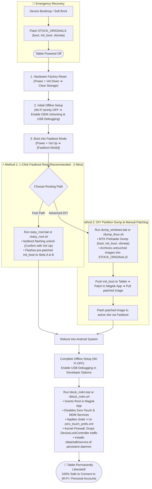

# 🔓 Acer One 8 (T4-82L Gen 2) Root, Zero-Touch / MDM Bypass & Firmware Restore Toolkit

<div align="center">

[](https://github.com/Zwitter01/AcerOne8-FirmwareRestore/stargazers)
[](https://github.com/Zwitter01/AcerOne8-FirmwareRestore/network/members)
[](LICENSE)
[-success?style=for-the-badge&logo=android)](https://github.com/Zwitter01/AcerOne8-FirmwareRestore)
[-orange?style=for-the-badge&logo=mediatek)](https://github.com/Zwitter01/AcerOne8-FirmwareRestore)
[-red?style=for-the-badge&logo=magisk)](https://github.com/topjohnwu/Magisk)
[](#-defeating-the-tectoro-pvt-ltd--google-zero-touch-lock)

<p align="center">
  <b>The definitive, automated all-in-one toolkit to unlock bootloader, 1-click root with Magisk (GKI), permanently neutralize institutional Google Zero-Touch & MDM enterprise locks ("Your device at work" / Tectoro Pvt Ltd), restore stock firmware, and flash custom LineageOS GSI ROMs on the Acer One 8 (T4-82L Gen 2).</b>
</p>

[📥 Download Repository (.ZIP)](https://github.com/Zwitter01/AcerOne8-FirmwareRestore/archive/refs/heads/main.zip) • [⚡ 1-Click Root](#-method-1-1-click-fastboot-root-recommended---2-minutes) • [🛡️ Zero-Touch Bypass](#-defeating-the-tectoro-pvt-ltd--google-zero-touch-lock) • [🛟 Firmware Restore](#-emergency-unbrick--stock-firmware-restore-guide) • [🚀 GSI Flashing](#-flashing-lineageos--custom-gsi-roms) • [❓ FAQ](#-comprehensive-troubleshooting--faq)

</div>

---

## 📑 Table of Contents
- [🌟 Key Highlights & Features](#-key-highlights--features)
- [🗺️ Complete Architecture & Workflow Diagram](#️-complete-architecture--workflow-diagram)
- [📱 Device Architecture & Specifications](#-device-architecture--specifications)
- [🔍 Technical Deep Dive & Reverse-Engineering Discoveries](#-technical-deep-dive--reverse-engineering-discoveries)
- [📂 Repository Directory Structure](#-repository-directory-structure)
- [⚙️ Step 0: One-Click Environment Setup (Fresh PC: Windows & Linux)](#️-step-0-one-click-environment-setup-fresh-pc-windows--linux)
- [⚡ Method 1: 1-Click Fastboot Root (Recommended - 2 Minutes)](#-method-1-1-click-fastboot-root-recommended---2-minutes)
- [🛠️ Method 2: Advanced DIY Partition Dump & Manual Magisk Patching](#️-method-2-advanced-diy-partition-dump--manual-magisk-patching)
- [🛡️ Defeating the "Tectoro Pvt Ltd" / Google Zero-Touch Lock](#-defeating-the-tectoro-pvt-ltd--google-zero-touch-lock)
- [🛟 Emergency Unbrick & Stock Firmware Restore Guide](#-emergency-unbrick--stock-firmware-restore-guide)
- [🚀 Flashing LineageOS / Custom GSI ROMs](#-flashing-lineageos--custom-gsi-roms)
- [❓ Comprehensive Troubleshooting & FAQ](#-comprehensive-troubleshooting--faq)
- [📜 License & Disclaimer](#-license--disclaimer)

---

## 🌟 Key Highlights & Features

- ⚡ **1-Click Fastboot Root:** Instant bootloader unlock and root flashing using the pre-tested, verified `tablet_backup/init_boot_patched.img`. No complex manual terminal commands needed.
- 🛡️ **Permanent Zero-Touch / MDM Bypass:** Defeats "Your device at work" and Tectoro enterprise locks with a multi-layered defense (Package disabler, immutable config locks, kernel-level `iptables` firewall, and a persistent Magisk boot daemon).
- 🛟 **Complete Firmware Restore & Emergency Unbrick:** Restore untouched stock partition images (`boot_a/b`, `init_boot_a/b`, `vbmeta_a/b`) in seconds to recover from any soft-brick or bootloop.
- 🔧 **Helio G85 Preloader Fixes:** Includes custom-patched low-level tools that eliminate MediaTek G85 crashes (`USBError 5` watchdog lock and 0-byte MEID unpack buffer error).
- 🪟🐧 **Cross-Platform Automated Setup:** Automated scripts for Windows (`setup_windows.bat` / `.ps1`) and Linux (`setup_linux.sh`) automatically stage ADB, Fastboot, Python, UsbDk, and drivers without touching global system paths.
- 🚀 **Treble GSI Ready:** Tested compatibility with pure LineageOS ARM64 A/B Generic System Images via `fastbootd`.

---

## 🗺️ Complete Architecture & Workflow Diagram



---

## 📱 Device Architecture & Specifications

| Property | Value / Technical Specification |
| :--- | :--- |
| **Device Model** | Acer One 8 (T4-82L Gen 2 / T4-82L-G2) |
| **Board / Platform** | `tb8786p1_64_k66` |
| **Processor (SoC)** | MediaTek MT6768 / MT6769 (Helio P65 / Helio G85 k68v1) |
| **Partitioning Scheme** | A/B Dynamic Partitions (Slot `b` active by default) |
| **Android Version** | Android 14+ / Generic Kernel Image (GKI v4) |
| **Ramdisk Architecture** | Located strictly inside `init_boot` partition (**NOT** in `boot`) |
| **Target Build Discovered** | `Acer_20261021` (Custom OEM / Government Distribution Build) |
| **Institutional Context** | Distributed under student empowerment schemes (DgShakti / UP Free Tablet Scheme / Swami Vivekananda Yuva Sashaktikaran Yojana) |
| **Enterprise Management** | Google Zero-Touch Enrollment tied to hardware IMEI / Tectoro Pvt Ltd portal |

---

## 🔍 Technical Deep Dive & Reverse-Engineering Discoveries

### 1. The Missing "Wipe Data / Factory Reset" Trap
Institutional builds intentionally remove the standard recovery menu option for user data wiping to prevent students from wiping management policies. Running `fastboot -w` fails when the bootloader is locked.
- **The Solution:** MediaTek Factory Mode (`Power + Volume Down`) boots an engineering hardware test environment that contains **`Clear Storage`** (or `Clear eMMC`), cleanly formatting `userdata` at the block layer.

### 2. Pre-Bundled Working GKI Magisk Image (`init_boot_patched.img`)
All tablets distributed under this hardware revision share the identical GKI v4 boot header. By bundling a pre-patched, tested **`tablet_backup/init_boot_patched.img`**, this toolkit spares you from:
- USB driver handshake timing loops during preloader mode.
- Android 14 storage scoped-directory bugs (*"Unable to extract boot image"* in Magisk file picker).
- Hours of manual dumping and configuration.

### 3. Helio G85 MTK Preloader Bug Fixes
For users choosing to dump partitions directly via `mtkclient`, stock MediaTek Helio G85 firmware introduces two breaking crashes:
- **Watchdog Register Lock (`USBError 5`):** The watchdog register write triggers an immediate USB endpoint hang. Solved by passing `--skipwdt` and wrapping the watchdog write in `try...except` within `mtk_preloader.py`.
- **0-Byte MEID Crash (`struct.error: unpack requires a buffer of 4 bytes`):** Modern MediaTek preloaders return an empty buffer for MEID instead of 4 bytes. Solved with a buffer length check (`len(buf) == 4`) prior to unpacking.

---

## 📂 Repository Directory Structure

```text
AcerOne8-FirmwareRestore/
├── .gitignore                     # Git rules (excludes heavy dumps & temporary caches)
├── LICENSE                        # MIT Open Source License
├── README.md                      # Comprehensive project documentation
├── block_mdm.bat                  # Windows 1-click Anti-MDM & Zero-Touch neutralizing script
├── block_mdm.ps1                  # PowerShell core script for Anti-MDM
├── block_mdm.sh                   # Linux/macOS bash script for Anti-MDM
├── dump_windows.bat               # Windows low-level live partition dumper launcher
├── dump_windows.ps1               # PowerShell partition dumper (saves to STOCK_ORIGINALS)
├── dump_linux.sh                  # Linux bash partition dumper via mtkclient
├── easy_root.bat                  # Windows 1-click automated Fastboot unlock & root
├── easy_root.ps1                  # PowerShell automated root script
├── easy_root.sh                   # Linux 1-click automated Fastboot unlock & root
├── mtk_preloader.py               # Patched MediaTek preloader communication handler
├── setup_windows.bat              # Windows fresh PC environment installer launcher
├── setup_windows.ps1              # PowerShell automated downloader (ADB, Fastboot, UsbDk, Magisk)
├── setup_linux.sh                 # Linux automated dependency installer (apt/udev/python)
├── tablet_backup/
│   ├── init_boot_patched.img      # Pre-compiled, verified Magisk root partition (GKI v4)
│   └── STOCK_ORIGINALS/           # (User generated / downloaded stock backup storage)
└── tools/                         # Staged binaries (platform-tools, mtkclient, zadig, drivers)
```

---

## ⚙️ Step 0: One-Click Environment Setup (Fresh PC: Windows & Linux)

You do **not** need to install global ADB/Fastboot or manually hunt down sketchy drivers across the web. The setup scripts automatically download and configure all dependencies locally inside `tools/`.

### 1. Download or Clone This Repository
```bash
git clone https://github.com/Zwitter01/AcerOne8-FirmwareRestore.git
cd AcerOne8-FirmwareRestore
```
*Or download directly without Git: [📥 Download Repository ZIP](https://github.com/Zwitter01/AcerOne8-FirmwareRestore/archive/refs/heads/main.zip) and extract it to a folder on your computer.*

### 2. Run Automated Setup

#### 🪟 On Windows:
Double-click **`setup_windows.bat`** (or open PowerShell in the directory and run `.\setup_windows.bat`).

**What this automatically does:**
- Downloads Google Android SDK Platform-Tools (`adb.exe`, `fastboot.exe`) into `tools\platform-tools\`.
- Downloads the official **Magisk APK** directly into `tablet_backup\Magisk.apk`.
- Verifies Python installation (silently configures if missing).
- Stages Google USB Drivers and UsbDk (MediaTek low-level communication driver).
- Prepares `mtkclient` virtual environment for partition dumping.

#### 🐧 On Linux:
```bash
chmod +x setup_linux.sh && ./setup_linux.sh
```

---

## ⚡ Method 1: 1-Click Fastboot Root (Recommended - 2 Minutes)

> [!TIP]
> This is the fastest, safest, and recommended method for 99% of users. It uses the pre-tested, verified Magisk image included in `tablet_backup/init_boot_patched.img`.

> [!CAUTION]
> ### ⚠️ CRITICAL RULE: NEVER CONNECT TO WI-FI DURING INITIAL SETUP!
> The tablet's serial number and IMEI are registered with Google Zero-Touch servers. If you connect to Wi-Fi before running `block_mdm`, Google Play Services will immediately download the management profile and lock your tablet with a wipe countdown timer.
> - Always tap **"Set up offline"** or **"Skip"** during initial Android setup.
> - **Keep Wi-Fi OFF** until the anti-MDM script confirms complete liberation.

### Step 1: Hardware Factory Reset (Clear Storage)
1. Turn your tablet completely **OFF**.
2. Press and hold **Power + Volume Down** until the MediaTek Factory Mode menu appears.
3. Use the **Volume Down** button to navigate to **Clear Storage** (or `Clear eMMC`).
4. Press the **Power button** to confirm. The tablet will format userdata and reboot.
5. In the Android setup wizard, tap **"Set up offline"** / **"Skip"** (**DO NOT connect to Wi-Fi**).
6. Go to **Settings > About tablet** and tap **Build number** 7 times to enable Developer options.
7. Go to **Settings > System > Developer options** and toggle **OEM unlocking** and **USB debugging** to **ON**.

### Step 2: Boot into Fastboot Mode
1. Power OFF the tablet completely.
2. Hold **Power + Volume Up** until the boot selection menu appears.
3. Press **Volume Up** to select `[Fastboot Mode]`, then press **Volume Down** to enter it.
4. Plug in the USB cable to your computer.

### Step 3: Run 1-Click Root
- **Windows:** Double-click **`easy_root.bat`** (or run `.\easy_root.ps1`).
- **Linux:** Run `./easy_root.sh`.

> ⚠️ **LOOK AT TABLET SCREEN:** When prompted by the script on your terminal, look at the tablet screen and press **Volume Up** to confirm the bootloader unlock!

The script will automatically:
1. Verify Fastboot USB connection.
2. Unlock the bootloader (`fastboot flashing unlock`).
3. Flash the verified Magisk root image to both `init_boot_a` and `init_boot_b`.
4. Reboot the tablet into Android.

### Step 4: Complete Offline Setup & Enable USB Debugging
1. When Android boots up, choose **"Set up offline"** or **Skip**. (**Keep Wi-Fi OFF!**)
2. Go to **Settings > About tablet** and tap **Build number** 7 times.
3. Go to **Settings > System > Developer options** and turn **USB debugging** to **ON**.

### Step 5: Run the Anti-MDM Script
Keep the tablet plugged into your computer and run:
- **Windows:** Double-click **`block_mdm.bat`**.
- **Linux:** Run `./block_mdm.sh`.

> 📱 **ACTION ON TABLET:** When prompted by the Magisk app on the tablet screen, grant **Superuser / Root permission** (`Grant Forever`).

The script will automatically:
- Install the Magisk APK on the device.
- Confirm root access (`uid=0`).
- Disable Zero-Touch activities and GMS sync tasks.
- Lock `zero_touch_prefs.xml` with immutable block attributes (`chattr +i`).
- Apply kernel-level `iptables` drop rules to silence `com.android.devicelockcontroller`.
- Install the persistent boot daemon at `/data/adb/service.d/block_mdm.sh`.

🎉 **CONGRATULATIONS! Your Acer One 8 is now 100% permanently rooted, free of MDM, and completely safe to connect to Wi-Fi!**

---

## 🛠️ Method 2: Advanced DIY Partition Dump & Manual Magisk Patching

*(For developers, alternative firmware versions, or anyone wishing to generate their own stock backups from scratch).*

### Step 1: Bootloader Unlock
1. Enable **OEM unlocking** and **USB debugging** in Developer options.
2. Reboot into Fastboot mode:
   ```cmd
   tools\platform-tools\adb.exe reboot bootloader
   ```
3. Unlock the bootloader:
   ```cmd
   tools\platform-tools\fastboot.exe flashing unlock
   ```
4. Press **Volume Up** on the tablet to confirm the unlock.
5. Reboot tablet:
   ```cmd
   tools\platform-tools\fastboot.exe reboot
   ```
6. Complete offline setup again and re-enable **USB debugging**.

### Step 2: Live Low-Level Partition Dump via mtkclient
From the repository root folder, run:
- **Windows:** Double-click `dump_windows.bat`.
- **Linux:** Run `./dump_linux.sh`.

**Connection Procedure:**
1. Power OFF your tablet completely.
2. When the terminal prompts `Waiting for PreLoader VCOM`, hold **BOTH Volume Up + Volume Down** (do **NOT** press Power).
3. Connect the USB cable while holding both volume buttons.
4. Keep holding until the script handshakes with the bootrom/preloader and dumps:
   - `boot_a.img` & `boot_b.img`
   - `init_boot_a.img` & `init_boot_b.img`
   - `vbmeta_a.img` & `vbmeta_b.img`
5. Untouched stock copies are automatically archived in `tablet_backup\STOCK_ORIGINALS\`.

### Step 3: Patching init_boot with Magisk
1. Push `init_boot_b.img` to the tablet:
   ```cmd
   tools\platform-tools\adb.exe push tablet_backup\init_boot_b.img /sdcard/Download/init_boot.img
   ```
2. Install Magisk APK:
   ```cmd
   tools\platform-tools\adb.exe install -r tablet_backup\Magisk.apk
   ```
3. Open Magisk on the tablet $\rightarrow$ tap **Install** $\rightarrow$ **Select and Patch a File**.
   > [!TIP]
   > **Fixing "Unable to extract boot image" Error:** In the Android file picker, tap the hamburger menu (three horizontal lines in top-left), select **Internal Storage** directly (do not choose "Recent" or the "Downloads" shortcut), and select `init_boot.img`.
4. Pull the patched image back to your PC:
   ```powershell
   $PATCHED = (.\tools\platform-tools\adb.exe shell "ls /sdcard/Download/magisk_patched-*.img").Trim()
   .\tools\platform-tools\adb.exe pull "$PATCHED" tablet_backup\magisk_patched.img
   ```
5. Flash via Fastboot:
   ```cmd
   tools\platform-tools\adb.exe reboot bootloader
   tools\platform-tools\fastboot.exe flash init_boot_b tablet_backup\magisk_patched.img
   tools\platform-tools\fastboot.exe reboot
   ```
6. Proceed to run **`block_mdm.bat`** (or `./block_mdm.sh`).

---

## 🛡️ Defeating the "Tectoro Pvt Ltd" / Google Zero-Touch Lock

### The Mechanics of the Enterprise Lock
The tablet's serial number and IMEI are enrolled in an enterprise database (**Tectoro Pvt Ltd**). The moment the tablet connects to the internet, Google Play Services (GMS) receives a Zero-Touch enrollment token. This invokes Android Device Policy to silently download enterprise management payloads and trigger an irreversible countdown:
> *"Your device will automatically reset in 1 hour 55 minutes."*

### The Multi-Layer Defense Architecture

```mermaid
graph LR
    subgraph L1["Layer 1: Component Disabling"]
        D1["Disable FactoryResetActivity"]
        D2["Disable ZeroTouchGmsTaskService"]
        D3["Disable managedprovisioning"]
        D4["Disable com.chipc.update"]
    end

    subgraph L2["Layer 2: File Lock"]
        F1["Truncate zero_touch_prefs.xml"]
        F2["chattr +i (Immutable Flag)"]
    end

    subgraph L3["Layer 3: Kernel Firewall"]
        K1["Detect UID of DeviceLockController"]
        K2["iptables DROP Outbound Traffic"]
        K3["ip6tables DROP Outbound Traffic"]
    end

    subgraph L4["Layer 4: Persistence"]
        P1["/data/adb/service.d/block_mdm.sh"]
        P2["Executes on Every Android Boot"]
    end

    L1 --> L2 --> L3 --> L4
```



#### Option A: Automated Execution (Recommended)
With the tablet booted, rooted, and connected via USB with USB debugging enabled:
- **Windows:** Run `block_mdm.bat`
- **Linux:** Run `./block_mdm.sh`

#### Option B: Manual Execution via ADB Root Shell
If you prefer running commands manually:
```bash
tools/platform-tools/adb shell
su

# 1. Disable Zero-Touch & MDM packages
pm disable com.google.android.gms/.enterprise.zerotouch.ui.FactoryResetActivity
pm disable com.google.android.gms/.enterprise.zerotouch.businesslogic.ZeroTouchGmsTaskService
pm disable com.android.managedprovisioning
pm disable com.chipc.update

# 2. Lock down Zero-Touch preferences file
if [ -f /data/data/com.google.android.gms/shared_prefs/zero_touch_prefs.xml ]; then
    chattr -i /data/data/com.google.android.gms/shared_prefs/zero_touch_prefs.xml 2>/dev/null
    echo -n "" > /data/data/com.google.android.gms/shared_prefs/zero_touch_prefs.xml
    chmod 444 /data/data/com.google.android.gms/shared_prefs/zero_touch_prefs.xml
    chattr +i /data/data/com.google.android.gms/shared_prefs/zero_touch_prefs.xml 2>/dev/null
fi

# 3. Apply Kernel Firewall to drop DeviceLockController traffic
DLC_UID=$(pm list packages -U | grep com.android.devicelockcontroller | sed -n "s/.*uid://p")
if [ -n "$DLC_UID" ]; then
    iptables -C OUTPUT -m owner --uid-owner "$DLC_UID" -j DROP 2>/dev/null || iptables -I OUTPUT -m owner --uid-owner "$DLC_UID" -j DROP
    ip6tables -C OUTPUT -m owner --uid-owner "$DLC_UID" -j DROP 2>/dev/null || ip6tables -I OUTPUT -m owner --uid-owner "$DLC_UID" -j DROP
fi

# 4. Remove active enterprise policy tokens
rm -f /data/system/device_owner_2.xml /data/system/device_policies.xml
```

---

## 🛟 Emergency Unbrick & Stock Firmware Restore Guide

If your tablet ever bootloops, gets stuck in a restart loop, or you need to restore it back to 100% factory original state, follow these steps:

### 1. Stock Original Partitions
Make sure you have your untouched stock partition backup images inside `tablet_backup\STOCK_ORIGINALS\`:
- `boot_a.img` & `boot_b.img`
- `init_boot_a.img` & `init_boot_b.img`
- `vbmeta_a.img` & `vbmeta_b.img`

*(If you used `dump_windows.bat` or `dump_linux.sh`, these files are already preserved in `tablet_backup\STOCK_ORIGINALS\` automatically).*

### 2. Flash Untouched Stock Images via Fastboot
Boot into Fastboot Mode (`Power + Volume Up` $\rightarrow$ `[Fastboot Mode]`), connect the USB cable, and run:

#### 🪟 On Windows:
```cmd
tools\platform-tools\fastboot.exe flash init_boot_a tablet_backup\STOCK_ORIGINALS\init_boot_a.img
tools\platform-tools\fastboot.exe flash init_boot_b tablet_backup\STOCK_ORIGINALS\init_boot_b.img
tools\platform-tools\fastboot.exe flash boot_a tablet_backup\STOCK_ORIGINALS\boot_a.img
tools\platform-tools\fastboot.exe flash boot_b tablet_backup\STOCK_ORIGINALS\boot_b.img
tools\platform-tools\fastboot.exe flash vbmeta_a tablet_backup\STOCK_ORIGINALS\vbmeta_a.img
tools\platform-tools\fastboot.exe flash vbmeta_b tablet_backup\STOCK_ORIGINALS\vbmeta_b.img
tools\platform-tools\fastboot.exe reboot
```

#### 🐧 On Linux:
```bash
tools/platform-tools/fastboot flash init_boot_a tablet_backup/STOCK_ORIGINALS/init_boot_a.img
tools/platform-tools/fastboot flash init_boot_b tablet_backup/STOCK_ORIGINALS/init_boot_b.img
tools/platform-tools/fastboot flash boot_a tablet_backup/STOCK_ORIGINALS/boot_a.img
tools/platform-tools/fastboot flash boot_b tablet_backup/STOCK_ORIGINALS/boot_b.img
tools/platform-tools/fastboot flash vbmeta_a tablet_backup/STOCK_ORIGINALS/vbmeta_a.img
tools/platform-tools/fastboot flash vbmeta_b tablet_backup/STOCK_ORIGINALS/vbmeta_b.img
tools/platform-tools/fastboot reboot
```

---

## 🚀 Flashing LineageOS / Custom GSI ROMs

Because the Acer One 8 features full **Project Treble** and **Dynamic Partitions** support, you can flash clean AOSP or LineageOS Generic System Images (GSIs):

### Step 1: Download an ARM64 A/B GSI
Download an **ARM64 A/B GSI** (e.g., [AndyCGYan's LineageOS GSI Releases](https://github.com/AndyCGYan/lineage_build_unified/releases)):
- `arm64_bgN`: ARM64, B-slot/AB, with Google Apps (GApps), Non-root.
- `arm64_bvN`: ARM64, B-slot/AB, Vanilla (no GApps), Non-root.

Extract the downloaded archive so that you have `system.img` in your project folder.

### Step 2: Reboot to Fastbootd (Userspace Fastboot)
```cmd
tools\platform-tools\adb.exe reboot fastboot
```
*(The tablet screen will display `fastbootd` in large text).*

### Step 3: Flash Images and Wipe Userdata

#### Windows:
```cmd
tools\platform-tools\fastboot.exe --disable-verity --disable-verification flash vbmeta tablet_backup\STOCK_ORIGINALS\vbmeta_a.img
tools\platform-tools\fastboot.exe --disable-verity --disable-verification flash vbmeta_b tablet_backup\STOCK_ORIGINALS\vbmeta_b.img
tools\platform-tools\fastboot.exe flash system system.img
tools\platform-tools\fastboot.exe -w
tools\platform-tools\fastboot.exe reboot
```

#### Linux:
```bash
tools/platform-tools/fastboot --disable-verity --disable-verification flash vbmeta tablet_backup/STOCK_ORIGINALS/vbmeta_a.img
tools/platform-tools/fastboot --disable-verity --disable-verification flash vbmeta_b tablet_backup/STOCK_ORIGINALS/vbmeta_b.img
tools/platform-tools/fastboot flash system system.img
tools/platform-tools/fastboot -w
tools/platform-tools/fastboot reboot
```

---

## ❓ Comprehensive Troubleshooting & FAQ

### Q1: Fastboot says `< waiting for any device >` and never detects the tablet.
**Cause:** Windows has not associated the Android Bootloader interface driver with the connected device.
**Fix:**
1. Keep the tablet plugged in on the Fastboot screen.
2. Open **Device Manager** (`devmgmt.msc`).
3. Look under **Other devices** for `Android` with a yellow exclamation mark.
4. Right-click $\rightarrow$ **Update driver** $\rightarrow$ **Browse my computer for drivers** $\rightarrow$ Select `tools\drivers\usb_driver\`.
5. Choose **Android Device** $\rightarrow$ **Android Bootloader Interface** $\rightarrow$ Install.

### Q2: During partition dump, `mtkclient` disconnects or repeats "Waiting for device".
**Cause:** MediaTek Preloader VCOM driver handshake timed out.
**Fix:**
- Install UsbDk (`tools\UsbDk_1.0.22_x64.msi`) which enables libusb to claim raw USB endpoints.
- Ensure you hold **BOTH Volume Up + Volume Down** before inserting the USB cable, and do **NOT** press the Power button.
- If UsbDk doesn't attach, use **Zadig** (`tools\zadig-2.9.exe`) to install the `WinUSB` driver on the `MediaTek USB Port` or `Preloader USB VCOM Port`.

### Q3: Magisk App says "Unable to extract boot image" when patching `init_boot.img`.
**Cause:** Android Scoped Storage restriction in the recent documents picker.
**Fix:**
- When selecting the file in Magisk, tap the hamburger menu (three horizontal lines in top-left).
- Tap the **Tablet's internal storage** directly (e.g. "Acer One 8").
- Browse to the `Download/` directory and pick `init_boot.img`.

### Q4: My tablet connected to Wi-Fi and shows "Device will reset in 1 hour". Can it still be saved?
**Fix:**
1. Turn off Wi-Fi immediately.
2. If USB debugging is still accessible: run `block_mdm.bat` immediately!
3. If locked out: Perform a **Hardware Factory Reset** (Power + Volume Down $\rightarrow$ `Clear Storage`), follow Method 1 strictly offline, and run `block_mdm.bat` before connecting to Wi-Fi.

---

## 📜 License & Disclaimer

### Disclaimer
This toolkit and documentation are created for educational, research, and data recovery purposes to help owners maintain, restore, and gain administrative control over their personal hardware. Rooting, unlocking bootloaders, and modifying partitions carries inherent risks. The authors and contributors are not responsible for any damage, loss of data, or voided warranties resulting from the use of this software.

### License
This project is licensed under the **MIT License**. See the [LICENSE](LICENSE) file for complete details.

---

<div align="center">

**Created with ❤️ for the Android developer and student community.**  
If this toolkit helped you, please consider giving it a **⭐ Star** on GitHub!

**Repository:** [https://github.com/Zwitter01/AcerOne8-FirmwareRestore](https://github.com/Zwitter01/AcerOne8-FirmwareRestore)

</div>
